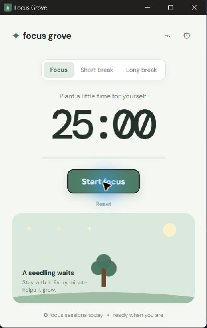

# Focus Grove

A genuinely lightweight desktop Pomodoro timer, made with Tauri and vanilla web UI.

It includes automatic day/night appearance based on local time, a native always-on-top pin, adjustable focus/break lengths, and two gentle visual motivators: **Grove** grows a tree as a session advances, while **Halloween** builds a playful haunted scene and reveals a harmless "Boo!" on completion.

## Screenshot

<p align="center">
  
</p>

The tree starts as a seedling and grows in four stages as the focus session progresses. Switch to the Halloween theme in **Settings** for the alternate haunted scene and completion surprise.

## Run locally

Install Node.js and Rust, then:

```bash
npm install
npm run dev
```

Create a native Windows installer with `npm run build`.

## Install on Windows

1. Run `npm run build` from the project folder.
2. Open **`src-tauri/target/release/bundle/nsis/Focus Grove_1.0.0_x64-setup.exe`**.
3. Follow the installer prompts.
4. Press the Windows key, search for **Focus Grove**, and open it from the Start menu.

The installer adds the Start-menu shortcut and an uninstall entry automatically. You can then use the pin button in the upper-right corner to keep the timer above other windows.

## Verification

The app source is syntax-checked with `npm run check`; the Tauri desktop binary is built with `npx tauri build --no-bundle` (or `npm run build` when generating bundles).
